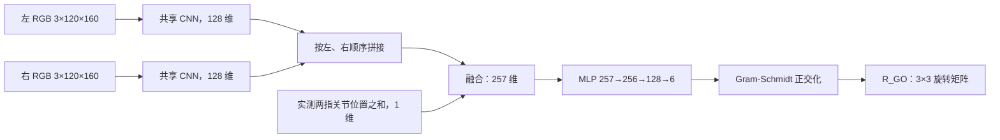

# InsertAnything：双侧视触觉与夹爪开度的物体相对旋转估计

更新：2026-10-12。第一版对象为用户选择的 **L 形插销**。所有新代码、数据、权重位于 `/data/nju/Lincao/InsertAnything_tactile`；原 InsertAnything、UniVTAC 和已有评估录像不改写。

当前默认采集与训练版本已升级为 **v2 分侧光学校准**，见[校准、重新采集与最新角度预测结果](README_insertanything_tactile_pose_v2.md)。下文网络与坐标定义仍适用；标有 v1 的数据、权重、命令和结果用于历史复现。新采集默认采用 v2，旧 28 mm 模式需显式传入 `--tactile_calibration legacy_shared`。

## 目标与参考论文

参考 [Zhao 等：Skill Generalization of Tubular Object Manipulation with Tactile Sensing and Sim2Real Learning](https://doi.org/10.1016/j.robot.2022.104321)，[作者机构公开全文](https://kclpure.kcl.ac.uk/ws/portalfiles/portal/190175282/RAS2022.pdf)。正文 3.2 节的 AngleNet 使用 ConvNeXt 回归管状物体相对触觉图像竖直轴的单一偏转角；论文另用 CTF-CycleGAN 处理仿真与真实图像域差异。

本版本按用户指定结构实现：**左右触觉 RGB → CNN 特征 → 左右特征拼接 → 融合实测手指开度 → MLP → 完整三维旋转**。借鉴论文的仿真自动标注和触觉姿态回归思路，预测目标扩展为物体相对夹爪的 SO(3) 旋转。使用现有 GelSight Mini / Taxim / PhysX 刚体胶垫，当前不包含 CTF-CycleGAN、实物数据或闭环策略反馈。

第一版只回归旋转；相对位置也采集保存，便于后续扩展。既有插入策略继续使用原状态观测，这个估计器不会自动修改其动作输入。

## 坐标系和真值

- 世界系 W：Isaac Sim 世界坐标系。
- 夹爪系 G：机器人 `panda_hand` 刚体链接坐标系，不使用带观测噪声的 policy 输入。
- 物体系 O：`HeldAsset` 根刚体链接坐标系，与被加载的 L 形插销资产一致。
- `R_WG`、`R_WO` 都将局部列向量变换到世界系；保存四元数顺序统一为 **wxyz**。

真值直接由每个采样时刻的物理刚体状态计算：

```text
R_GO = R_WG.T @ R_WO
p_GO = R_WG.T @ (p_WO - p_WG)
x_G  = R_GO @ x_O + p_GO
```

网络只读取左右图像和两指关节位移之和。上述物体/夹爪真值、随机种子和抓取编号用于监督、检查和分组，不输入网络。

`opening_joint_sum_m = q_left + q_right`，其中 q 是实际手指直线关节位置，单位米，不使用关节目标值。由于新夹爪包含传感器壳体和胶垫，这个量是 Panda 的关节开度编码；胶垫表面净间距还包含几何安装偏置。原始两指位置同时保存，后续可据资产标定净间距。

## 第一版网络

实现：[model.py](/data/nju/Lincao/InsertAnything_tactile/source/tactile_pose/model.py)。配置：[pose_v1.json](/data/nju/Lincao/InsertAnything_tactile/configs/pose_v1.json)。



两个分支共享同一个 CNN 权重，但左右特征始终按固定顺序拼接；原始图像不进行镜像或随机几何旋转。

| 模块 | 具体实现 |
|---|---|
| 图像预处理 | 原图 320×240；按相同比例缩放为宽 160、高 120；uint8/255；网络内部映射到 [-1,1] |
| CNN | 通道 3→24→48→96→128，4 层 stride=2 卷积；第一层 5×5，其余 3×3；GroupNorm + ReLU |
| 特征 | AdaptiveAvgPool(3,4) → 1536→128 全连接 |
| 开度 | 实测 q_left+q_right，除以 0.08 m 并映射到 [-1,1]；不对异常值静默裁剪 |
| 融合与回归 | 128+128+1=257 → 256 → 128 → 6，隐藏层 ReLU |
| 旋转输出 | 6D 表示旋转矩阵前两列，正交化后得到合法 SO(3)；退化向量有有效旋转回退 |
| 训练损失 | 预测 R 与真值 R 的 SO(3) 测地角，单位弧度；报告转换成度 |
| 参数量 | 461,574，约 0.462 M |

6D 是**三自由度旋转的参数表示**，并不表示预测平移＋旋转六自由度。采用 [Zhou 等，CVPR 2019 的连续旋转表示](https://openaccess.thecvf.com/content_CVPR_2019/html/Zhou_On_the_Continuity_of_Rotation_Representations_in_Neural_Networks_CVPR_2019_paper.html)。模型推理输出旋转矩阵，也提供 wxyz 四元数和仅用于显示的 XYZ 欧拉角。

## 采集

启动脚本复用已有 `/data/nju/Lincao/InsertAnything/.venv-isaac51/bin/python`，无需激活 Conda。当前环境已具备 torch、h5py、SciPy、Pillow、matplotlib；采集使用已配置的 Isaac Sim 5.1 / Isaac Lab 2.3 / TacEx。训练、检查和推理入口不启动 Isaac Sim。

小规模复现：

```bash
cd /data/nju/Lincao/InsertAnything_tactile
./scripts/python.sh scripts/collect_pose_data.py --headless --num_envs 1 --grasps 24 --frames_per_grasp 8 --seed 100
```

扩充为 120 次抓取：

```bash
cd /data/nju/Lincao/InsertAnything_tactile
./scripts/python.sh scripts/collect_pose_data.py --headless --num_envs 1 --grasps 120 --frames_per_grasp 8 --seed 1000
```

默认在 `outputs/pose_时间戳/` 创建新数据。可追加 `--output outputs/自定义新目录`，已有目录会被拒绝。脚本采集完指定次数即退出。

每次抓取均重新初始化并物理闭合夹爪。初始化时对物体抓取变换采样三轴扰动，默认 `--rotation_range_deg 20 20 35`，单位度；原任务配置不修改。之后执行 8 个零动作保持控制步，以 15 Hz 同步保存。扰动经过原初始化变换的逆变换和物理接触，其数值不等于最终相对姿态；**标签始终取实际刚体状态**。闭爪使部分朝向回正，因此实际覆盖范围应查看验证报告，不能用请求范围代替。

采样回调在每步物理/奖励更新之后、自动重置之前执行。`frames_per_grasp` 必须小于任务自动重置阈值。当前验证使用 1 个环境；代码提供环境编号和并行接口，但本姿态采集入口的并行规模尚未验收。

2026-10-12 补充：[左右光学零点诊断](README_insertanything_tactile_symmetry.md) 发现当前共用 28 mm 基准与左右胶垫安装位置不一致，影响触觉外观、压入代理和有效样本筛选。本文 v1 数据、模型及指标保留，均对应原基准；实际物体/夹爪位姿与旋转标签不由触觉零点计算。现已完成分侧校准并以 v2 记录版本，见[当前运行手册](README_insertanything_tactile_pose_v2.md)。

## 数据字段

每次采集目录包含 `samples.h5` 和 `metadata.json`。HDF5 各字段首维 N 都是同步样本数；每行包含同一个环境、同一时刻的双侧图像及实际状态。

| HDF5 字段 | 形状/含义 |
|---|---|
| `tactile/left/rgb`、`tactile/right/rgb` | `[N,240,320,3] uint8`，左右原始 RGB，LZF 无损压缩 |
| `tactile/{left,right}/press_depth_mm` | `[N,240,320] float32`，几何压入代理深度，用于检查接触 |
| `gripper/finger_joint_position_m` | `[N,2]`，左/右实际手指关节位置 |
| `gripper/opening_joint_sum_m` | `[N,1]`，上述两指位置之和，网络输入 |
| `gripper/position_w_m`、`quaternion_wxyz` | `[N,3]` / `[N,4]`，夹爪实际世界位姿 |
| `object/position_w_m`、`quaternion_wxyz` | `[N,3]` / `[N,4]`，物体实际世界位姿 |
| `target/rotation_go`、`quaternion_go_wxyz` | `[N,3,3]` / `[N,4]`，物体相对夹爪的旋转真值 |
| `target/position_go_m` | `[N,3]`，物体相对夹爪的位置真值，v1 不回归 |
| `robot/joint_position`、`joint_velocity` | `[N,9]`，机械臂和手指实际关节状态 |
| `sensor/position_w_m`、`quaternion_wxyz` | `[N,2,3]` / `[N,2,4]`，左右传感器壳体链接的世界位姿 |
| `time/grasp_step`、`grasp_time_s` | 抓取后的控制步和时间，不含初始化内部步骤 |
| `time/policy_physics_step` | 环境累计控制循环内的物理步数，不含初始化内部步骤 |
| `time/sim_time_s` | 仿真器实际时间，包含初始化的内部步骤 |
| `ids/env_id`、`grasp_id`、`object_id` | 环境编号、独立抓取编号、物体编号；物体编号对应 metadata 的 objects 字典 |
| `random/seed`、`reset_seed` | 该抓取朝向采样的种子、该批环境实际 reset 的种子 |
| `random/requested_euler_xyz_deg` | 请求的初始化扰动，仅供审计，不作为标签或网络输入 |
| `contact/{left,right}_pixels`、`*_max_press_mm`、`*_valid` | 接触像素数、最大几何压入和各侧接触标志 |
| `contact/both_valid` | 左右接触条件同时成立 |
| `quality/sample_valid`、`status_code` | 训练有效性和采集状态位掩码 |
| `quality/terminated`、`truncated` | 原环境终止标志 |

默认接触有效条件：各侧至少 64 个像素的几何压入大于 0.02 mm。它是**图像几何接触代理判定**，不表示经过标定的接触力或真实胶体应变。有效训练样本还需数值有限、物体距夹爪原点小于 0.25 m、实际关节开度在 `(0,0.081)` m。

状态 `0` 为有效；非零按位组合：`1` 左接触不足、`2` 右接触不足、`4` 非有限数值、`8` 位姿/开度越界。无效样本保留，训练时过滤。整个文件只有 `status=complete` 时才能进入训练，失败或未完成采集不会静默作为训练数据。

`dataset_uuid + grasp_id` 唯一标识一次独立抓取，避免不同采集文件的 grasp_id 从零开始而冲突。元数据记录物体资产路径及 SHA256、坐标定义、关节名字、采样周期、随机范围、接触阈值和运行状态。

检查与查看：

```bash
cd /data/nju/Lincao/InsertAnything_tactile
./scripts/python.sh scripts/inspect_pose_data.py outputs/pose_lhole_v1_120grasps_20261012/samples.h5
```

生成 `validation.json`、`rotation_coverage.png` 和 `grasp_preview.png`。检查包含 SciPy 独立重算相对变换、SO(3) 正交性、四元数一致性、开度求和、接触阈值、抓取内时间与步骤连续性，以及全部字段的形状和有限值（v1 38 个，v2 40 个；v2 额外核对原始深度与分侧零点）。

## 训练、评估与推理

示例使用已采集的 120 次抓取扩充批；新采集后替换 `--data`：

```bash
cd /data/nju/Lincao/InsertAnything_tactile
./scripts/python.sh scripts/train_pose.py --data outputs/pose_lhole_v1_120grasps_20261012/samples.h5 --epochs 50 --device cuda:0
```

默认训练配置：AdamW，学习率 0.001、weight decay 0.0001、batch 32、50 epochs、训练种子 0。不下载预训练权重，从头训练。所有预处理设置写入 checkpoint，推理复用相同图像缩放及开度单位。

默认按有效的**独立抓取**分配约 70%/15%/15% 训练/验证/测试，保存完整 `splits.json`。同一抓取的所有帧进入同一集合；不进行逐帧随机划分。只有训练标签用于计算平均旋转初始化和常数预测基线；`best.pt` 按验证集平均测地角选择，测试集在选好模型后评估。

输出包含 `best.pt`、`last.pt`、`history.jsonl`、`metrics.json`、`test_predictions.npz` 和配置/划分文件。权重文件只保存推理所需的模型及元数据，当前训练脚本没有优化器断点续训入口。

独立评估扩充批权重：

```bash
cd /data/nju/Lincao/InsertAnything_tactile
./scripts/python.sh scripts/evaluate_pose.py --checkpoint outputs/pose_lhole_v1_120grasps_train_20261012/best.pt --split test --output outputs/pose_lhole_v1_test_review_20261012
```

输出每帧预测旋转/四元数、真值、误差及源文件/行号/抓取组编号。指标包括平均、中位数、RMSE、P95 旋转角误差，1°/3°/5°/10° 内比例，以及按抓取等权平均的误差，并与训练集平均旋转基线比较。

从 HDF5 的一行运行推理（只读取左右 RGB 和开度，不读取真值）：

```bash
cd /data/nju/Lincao/InsertAnything_tactile
./scripts/python.sh scripts/predict_pose.py --checkpoint outputs/pose_lhole_v1_120grasps_train_20261012/best.pt --data outputs/pose_lhole_v1_120grasps_20261012/samples.h5 --row 0
```

也可传独立图像：`--left_rgb /路径/左.png --right_rgb /路径/右.png --opening_m 实测两指位置之和`，替代 `--data --row`。输入为同一采样时刻的左右图像；两侧顺序、传感器朝向和开度定义应与训练一致。

## 实测记录和当前边界

首批 `outputs/pose_lhole_v1_pilot_20261012/`：24 次抓取、192 组图像，其中 20 次抓取的 160 组满足训练有效性。划分为 14/3/3 次抓取、112/24/24 帧。真值矩阵与 SciPy 重算最大逐元素误差为 `7.03e-7`，测试涵盖坐标变换、6D 正交化及双图/开度反向梯度。

首批 50 轮训练虽能拟合训练样本，但验证误差未随之下降；按验证集选中的第 3 轮权重，测试平均角误差 **24.72°**，常数基线 **23.27°**。该次小样本模型未优于基线，保留作为流程验收与过拟合诊断，不能作为可用精度证明。

扩充批 [数据目录](/data/nju/Lincao/InsertAnything_tactile/outputs/pose_lhole_v1_120grasps_20261012/)：120 次独立抓取、960 组双侧图像，其中 112 次抓取的 878 组满足有效性条件。训练/验证/测试分别为 **78/17/17 次抓取、608/134/136 帧**。实际相对旋转真值与 SciPy 重算最大逐元素误差为 `7.51e-7`；所有 38 个字段的同步、有限值和接触检查通过。可查看 [双侧触觉样本预览](/data/nju/Lincao/InsertAnything_tactile/outputs/pose_lhole_v1_120grasps_20261012/grasp_preview.png) 和 [实际旋转覆盖图](/data/nju/Lincao/InsertAnything_tactile/outputs/pose_lhole_v1_120grasps_20261012/rotation_coverage.png)。

同一网络和配置训练 50 轮，按验证集选中 **第 9 轮**；[最终权重 best.pt](/data/nju/Lincao/InsertAnything_tactile/outputs/pose_lhole_v1_120grasps_train_20261012/best.pt)。训练时的 GPU 评估结果：

| 集合/指标 | 模型 | 固定输出训练集平均旋转 |
|---|---:|---:|
| 验证集平均角误差 | 7.61° | 13.57° |
| 测试集平均角误差 | **12.12°** | 18.44° |
| 测试集中位角误差 | 7.18° | 17.10° |
| 测试集 RMSE | 15.92° | 20.63° |
| 测试集 P95 | 34.54° | 33.21° |
| 测试集误差 ≤ 10° | 64.71% | 17.65% |

完整指标见 [训练 metrics.json](/data/nju/Lincao/InsertAnything_tactile/outputs/pose_lhole_v1_120grasps_train_20261012/metrics.json)；独立 CPU 评估入口也已执行，输出在 [保留集评估目录](/data/nju/Lincao/InsertAnything_tactile/outputs/pose_lhole_v1_120grasps_test_20261012/)，平均误差为 12.12195°，与训练入口的 GPU 结果 12.12179° 一致至显示精度。`predict_pose.py` 的 HDF5 和独立 PNG＋开度两种入口均已验证，同一输入的预测完全一致；7 项离线回归测试通过。所有历史试验都保留，不覆盖首批。

扩充批在平均误差上优于常数基线，但尾部误差仍然较大，P95 略高于基线。以上结果用于验证第一版采集、标签、学习与推理流程，**尚不能作为精密插入控制的可用精度证明**。同一次抓取内的 8 帧具有相关性，测试集有效独立规模是 17 次抓取，不应把 136 帧当作 136 次独立试验。

当前采集只覆盖可稳定夹持的有限朝向附近，尚不能据此声称覆盖完整 SO(3)。刚体胶垫与 Taxim 仿真数据也不能证明真实传感器泛化能力。L 形插销的局部接触可能仍有歧义；扩展到圆柱、六角等物体时，还需分析旋转对称性、可观测性及物体级测试划分。

## 代码位置与回归检查

- `source/tactile_pose/sim_collection.py`：采集专用环境子类、实际位姿读取和同步 HDF5 写入。
- `source/tactile_pose/rotations.py`：wxyz、相对变换、6D/SO(3) 转换与测地角。
- `source/tactile_pose/model.py`：双侧共享 CNN、开度融合、旋转回归。
- `source/tactile_pose/data.py`：有效样本过滤、按独立抓取划分、离线加载。
- `source/tactile_pose/evaluation.py`：模型加载、旋转误差及基线。
- `scripts/collect_pose_data.py`、`inspect_pose_data.py`、`train_pose.py`、`evaluate_pose.py`、`predict_pose.py`：对应运行入口。

```bash
cd /data/nju/Lincao/InsertAnything_tactile
PYTEST_DISABLE_PLUGIN_AUTOLOAD=1 ./scripts/python.sh -m pytest -q -p no:cacheprovider tests/test_pose.py
./scripts/python.sh scripts/verify_isolation.py
```

姿态离线包 `tactile_pose` 不导入 Isaac Sim，因此检查、训练和推理可在配置好的 Python 环境中独立运行。
